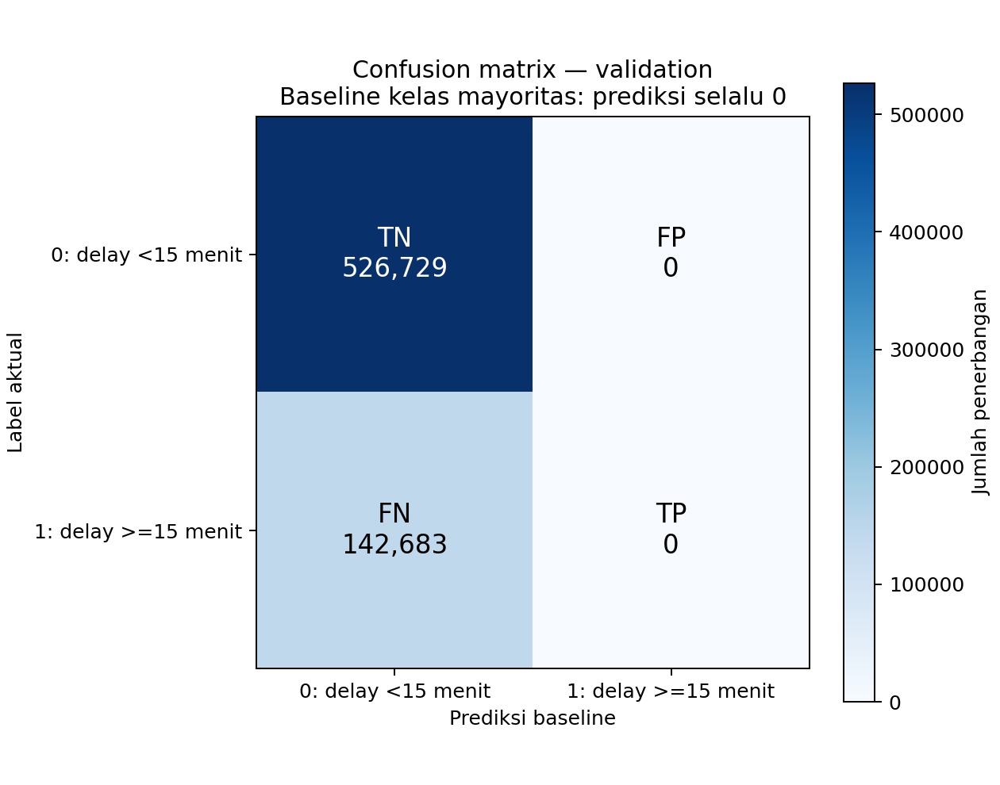

# Baseline kelas mayoritas — Klasifikasi Keterlambatan Keberangkatan

Dibuat (UTC): 2026-11-07T06:35:41.686875+00:00

## Tujuan dan metode

Baseline ini mengukur hasil ketika setiap penerbangan mendapat prediksi kelas yang paling sering muncul pada train. Model berikutnya dibandingkan dengan hasil ini untuk menilai manfaat prediksinya.

Label 0 berarti departure delay kurang dari 15 menit, termasuk keberangkatan lebih awal. Label 1 berarti departure delay minimal 15 menit. Populasi mengikuti preprocessing: non-cancelled dengan DEP_DELAY valid.

Kelas mayoritas yang dipilih dari train adalah **0**. Semua baris validation diprediksi sebagai **0**. Jika jumlah kedua kelas pada train sama, aturan tetap memilih kelas 0.

Baseline ini tidak memerlukan fitur X. Tidak ada threshold yang dituning, probabilitas risiko yang dipelajari, atau resampling. Data test tidak dibaca. Perhitungan confusion matrix dari jumlah kelas setara dengan membuat prediksi konstan untuk setiap baris validation.

## Distribusi label

| Subset | Total | Label 0 | Label 1 | Label 1 (%) |
| --- | ---: | ---: | ---: | ---: |
| train | 1,795,773 | 1,511,379 | 284,394 | 15.8369 |
| validation | 669,412 | 526,729 | 142,683 | 21.3147 |

## Evaluasi pada validation

Precision, recall, dan F1 berikut menggunakan kelas 1 (terlambat) sebagai kelas positif.

| Metrik | Nilai (0–1) | Persen | Keterangan |
| --- | ---: | ---: | --- |
| accuracy | 0.786853 | 78.6853% | Terdefinisi |
| precision_class_1 | 0.000000 | 0.0000% | Tidak terdefinisi; ditampilkan sebagai 0 |
| recall_class_1 | 0.000000 | 0.0000% | Terdefinisi |
| f1_class_1 | 0.000000 | 0.0000% | Terdefinisi |

Precision tidak terdefinisi bila tidak ada prediksi positif; recall tidak terdefinisi bila tidak ada label positif aktual. F1 tidak terdefinisi bila TP, FP, dan FN semuanya nol. Nilai tersebut ditampilkan sebagai 0 sesuai aturan laporan, dengan status tetap dicatat dalam JSON/CSV.

ROC-AUC dan PR-AUC tidak dievaluasi pada langkah ini. Prediksi kelas konstan tidak membedakan urutan risiko antar-penerbangan. Metrik berbasis skor akan digunakan pada model yang menghasilkan skor/probabilitas.

## Confusion matrix

Baris menunjukkan label aktual, kolom menunjukkan prediksi.

| Aktual / Prediksi | 0: delay <15 menit | 1: delay >=15 menit |
| --- | ---: | ---: |
| 0: delay <15 menit | 526,729 (TN) | 0 (FP) |
| 1: delay >=15 menit | 142,683 (FN) | 0 (TP) |

TN: kelas 0 dikenali dengan benar. FP: peringatan keterlambatan pada kelas 0. FN: keterlambatan yang terlewat. TP: keterlambatan yang terdeteksi.

## Interpretasi awal

Accuracy 78.6853% berasal dari keberhasilan menebak seluruh 526,729 penerbangan kelas 0. Semua 142,683 penerbangan terlambat terlewat karena tidak ada prediksi kelas 1. Jika validation memiliki label positif, recall kelas terlambat bernilai 0; accuracy saja tidak menunjukkan kemampuan mendeteksi keterlambatan.

Hasil ini menjadi pembanding bagi Logistic Regression dan model berikutnya pada validation yang sama. Perbaikan dinilai dari kemampuan mendeteksi keterlambatan beserta jumlah peringatan keliru, bukan hanya kenaikan accuracy. Test disimpan untuk evaluasi akhir setelah pilihan model/parameter ditetapkan.

## Input dan reproduksibilitas

- train: `D:\Coding\#bigdata\flight-delay-BI\classification\datasets\model-ready\y_train.npy`
  SHA-256: `f2322e9178b4856ed2dfdf76ce8b19d05e8e18b38d4e77d5412905f045876f96`
- validation: `D:\Coding\#bigdata\flight-delay-BI\classification\datasets\model-ready\y_validation.npy`
  SHA-256: `e2217fb8c387d4ec5ad02a7ad344ad4043bb4afc7744f880fd052e45a97f071a`

Versi: Python 3.11.9, NumPy 2.3.5, matplotlib 3.10.8.
Waktu proses: 0.26 detik.

Hasil perhitungan disimpan dalam JSON, tabel metrik/distribusi/confusion matrix dalam CSV, dan visualisasi dalam PNG. Menjalankan ulang skrip memperbarui file berawalan majority-baseline di folder output.
