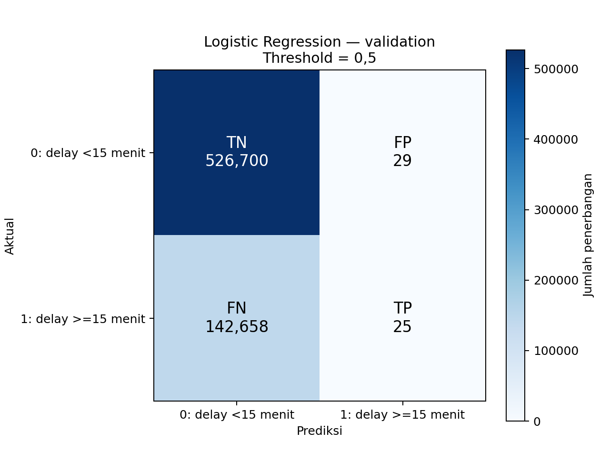
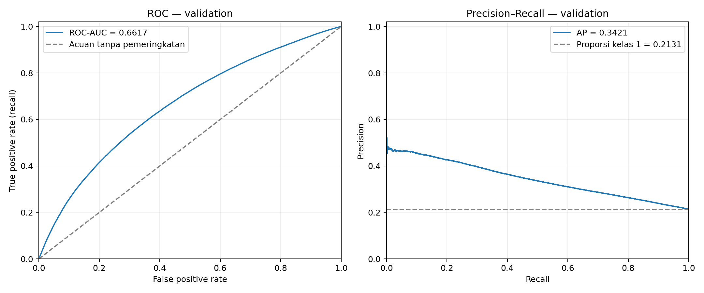

# Logistic Regression — Klasifikasi Keterlambatan Keberangkatan

Dibuat (UTC): 2026-11-07T10:32:54.374155+00:00

## Rancangan percobaan

Model dilatih pada matriks train hasil preprocessing dan dievaluasi pada validation. Label positif adalah DELAYED_15=1: departure delay minimal 15 menit, pada populasi non-cancelled dengan label tersedia.

Threshold awal ditetapkan 0,5 sebelum evaluasi: probabilitas kelas 1 >=0,5 menjadi prediksi 1. Belum ada tuning, class weighting, resampling, atau perubahan fitur. Test tidak dibaca. Transformer sebelumnya tidak di-fit ulang.

| Parameter | Nilai |
| --- | --- |
| solver | lbfgs |
| C | 1.0 |
| class_weight | None |
| max_iter | 1000 |
| tol | 0.0001 |
| random_state | 42 |
| Regularisasi | L2 (bawaan LogisticRegression) |

C=1 adalah pengaturan awal kekuatan regularisasi. Solver lbfgs digunakan untuk baseline ini. Penetapan parameter tersebut belum membuktikan bahwa nilainya optimal.

## Data

| Subset | Baris | Fitur | Label 0 | Label 1 |
| --- | ---: | ---: | ---: | ---: |
| train | 1,795,773 | 790 | 1,511,379 | 284,394 |
| validation | 669,412 | 790 | 526,729 | 142,683 |

## Status training

- Waktu fit: 7.72 detik.
- Iterasi solver: 76 dari batas 1000.
- Konvergensi solver: tercapai menurut status solver.

## Perbandingan pada validation

Baseline mayoritas dihitung ulang dari y_train dan y_validation yang sama, sehingga perbandingan tetap berlaku walaupun folder hasil baseline sebelumnya dipindah. Kelas mayoritasnya adalah 0.

| Metrik (0–1) | Mayoritas | Logistic Regression | Selisih LR − mayoritas |
| --- | ---: | ---: | ---: |
| Accuracy | 0.786853 | 0.786847 | -0.000006 |
| Precision kelas 1 | 0.000000 | 0.462963 | +0.462963 |
| Recall kelas 1 | 0.000000 | 0.000175 | +0.000175 |
| F1 kelas 1 | 0.000000 | 0.000350 | +0.000350 |
| ROC-AUC | — | 0.661688 | — |
| PR-AUC (trapesium) | — | 0.342042 | — |
| Average Precision (AP) | — | 0.342054 | — |

Precision, recall, dan F1 mengacu pada kelas terlambat. Precision dengan nol prediksi positif ditampilkan sebagai 0, dengan status tidak terdefinisi dicatat dalam JSON/CSV. Metrik pemeringkatan baseline kelas keras tidak dievaluasi.

PR-AUC (trapesium) mengintegrasikan kurva precision–recall secara linear. Average Precision (AP) merangkum precision dengan bobot kenaikan recall tanpa interpolasi linear; kedua angka dapat berbeda. ROC-AUC, PR-AUC, dan AP dihitung dari probabilitas, sehingga tidak bergantung pada threshold 0,5.

## Confusion matrix

| Aktual / Prediksi | 0 | 1 |
| --- | ---: | ---: |
| 0 | 526,700 (TN) | 29 (FP) |
| 1 | 142,658 (FN) | 25 (TP) |

## Kurva evaluasi

## Interpretasi hasil awal

Pada threshold 0,5, model mendeteksi 25 penerbangan terlambat (TP), melewatkan 142,658 (FN), dan menghasilkan 29 peringatan keliru (FP).
Accuracy = 78.6847%; recall kelas terlambat = 0.0175%; precision kelas terlambat = 46.2963%.

Nilai metrik perlu dibaca bersama trade-off deteksi keterlambatan dan peringatan keliru. Konvergensi solver bukan bukti kualitas prediksi. Jika model belum konvergen, tinjau training terlebih dahulu; jika sudah konvergen, hasil ini menjadi acuan untuk eksperimen threshold atau class weighting pada validation. Test tetap untuk evaluasi akhir.

## Artefak

- logistic-regression-model.joblib: model terlatih, menerima matriks dengan urutan fitur pada feature_contract.json yang dipakai saat training.
- logistic-regression-results.json: metrik, parameter, status konvergensi, versi, dan identitas input.
- logistic-regression-metrics.csv: perbandingan metrik LR dan mayoritas, termasuk status precision.
- logistic-regression-confusion-matrix.csv dan PNG: tabel serta visualisasi kesalahan.
- logistic-regression-curves.png: kurva ROC dan precision–recall.
- logistic-regression-validation-predictions.npz: dataset_row (mulai 1), y_true, y_pred, probability_class_1. Urutan sama dengan matriks validation dan CSV prepared; dapat dipakai untuk analisis threshold berikutnya.
- logistic-regression-coefficients.csv: koefisien sesuai urutan fitur. Koefisien mengacu pada skala fitur setelah preprocessing; bukan bukti sebab-akibat.

## Reproduksibilitas

- feature_contract: `D:\Coding\#bigdata\flight-delay-BI\classification\outputs\feature_contract.json`
  SHA-256: `197c7ee9c2316bd973fe8986c124d1fc93e096a7292de06b4fa1853ce82ef964`
- X_train: `D:\Coding\#bigdata\flight-delay-BI\classification\datasets\model-ready\X_train.npz`
  SHA-256: `12da52d5bd02b9a460b37c0c5299c2e406eac3135823538d78afc7bb4ebdb434`
- y_train: `D:\Coding\#bigdata\flight-delay-BI\classification\datasets\model-ready\y_train.npy`
  SHA-256: `f2322e9178b4856ed2dfdf76ce8b19d05e8e18b38d4e77d5412905f045876f96`
- X_validation: `D:\Coding\#bigdata\flight-delay-BI\classification\datasets\model-ready\X_validation.npz`
  SHA-256: `9cfbf3af8f841724dd7cb3b49b5314e5c5501d5bceada3efb719588e0f4dea39`
- y_validation: `D:\Coding\#bigdata\flight-delay-BI\classification\datasets\model-ready\y_validation.npy`
  SHA-256: `e2217fb8c387d4ec5ad02a7ad344ad4043bb4afc7744f880fd052e45a97f071a`

Versi: python 3.11.9, numpy 2.3.5, scipy 1.17.0, scikit-learn 1.8.0, matplotlib 3.10.8, joblib 1.5.3.

Model memakai matriks yang sudah ditransformasi. Untuk penerbangan baru, gunakan aturan FE dan transformer preprocessing yang sama sebelum model ini. Jika melakukan cross-validation, fit ulang preprocessing di setiap fold dari CSV prepared.
